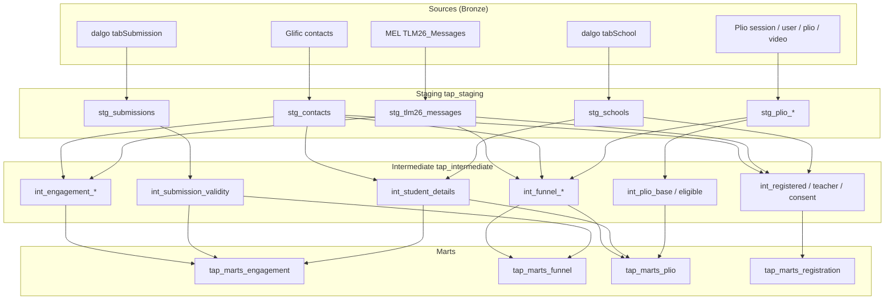
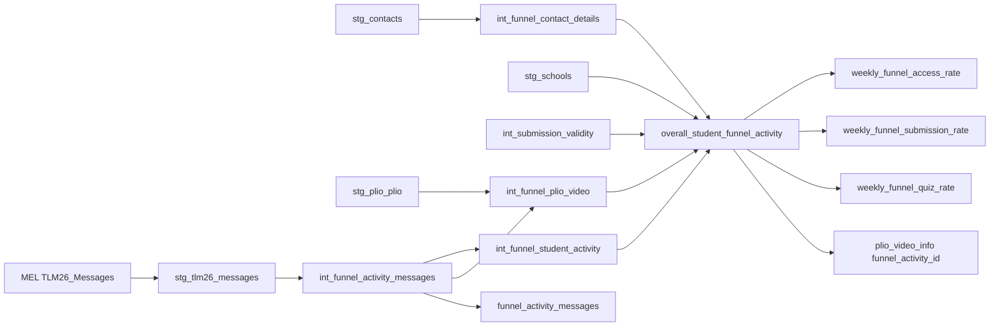

# TLM26 TAP Pipeline — ER / lineage

Gold datasets: `tap_marts_plio`, `tap_marts_engagement`, `tap_marts_funnel`, `tap_marts_registration`.

## 1. High-level layers

## 1b. Funnel flow

MEL `TLM26_Messages` only (no live Glific union). Curriculum id = `TLM26 - U1 - Activity RA1` (CA/RA). Grain of gold fact = phone × activity_id.

## 2. Entity relationships (keys)

```mermaid
erDiagram
  stg_contacts ||--o{ int_student_details : "phone / glific_id"
  stg_contacts ||--o{ int_registered_students : "phone"
  stg_contacts ||--o{ int_engagement_flow_start : "phone exclude TapTeam"

  stg_tlm26_messages ||--o{ int_engagement_flow_start : "Flow Start spine"
  stg_tlm26_messages ||--o{ int_engagement_access : "Activity_Access"
  stg_tlm26_messages ||--o{ int_engagement_submission : "Submission_Received"
  stg_tlm26_messages ||--o{ int_engagement_flow_complete : "Flow_end"
  stg_tlm26_messages ||--o{ int_tlm26_activity_message_events : "quiz tags"
  stg_tlm26_messages ||--o{ int_parent_consent : "ParentConsent"
  stg_tlm26_messages ||--o{ int_teacher_welcome_start : "TeacherWelcome"
  stg_tlm26_messages ||--o{ int_teacher_student_link : "student link"
  stg_tlm26_messages ||--o{ int_funnel_activity_messages : "TLM26 U RA/CA labels"

  int_tlm26_activity_message_events ||--|| int_engagement_quiz_flags : "phone last-10"

  stg_submissions ||--|| int_submission_validity : "latest Valid/Invalid per student_id"

  stg_schools ||--o{ int_eligible_students : "school_join_key"
  stg_schools ||--o{ overall_student_engagement_activity : "school"
  int_student_details ||--o{ int_eligible_students : "glific_id"
  stg_plio_user ||--o{ int_eligible_students : "unique_id = glific"

  stg_plio_session ||--o{ int_plio_base : "session"
  stg_plio_user ||--o{ int_plio_base : "user_id"
  stg_plio_plio ||--o{ int_plio_base : "plio_id"
  stg_plio_video ||--o{ int_plio_base : "video"

  int_engagement_flow_start ||--o{ overall_student_engagement_activity : "spine phone x unit x activity"
  int_engagement_access ||--o{ overall_student_engagement_activity : "access_flag"
  int_engagement_submission ||--o{ overall_student_engagement_activity : "submission_flag"
  int_engagement_flow_complete ||--o{ overall_student_engagement_activity : "completion_flag phone"
  int_engagement_quiz_flags ||--o{ overall_student_engagement_activity : "quiz flags phone"
  int_student_details ||--o{ overall_student_engagement_activity : "student_id ST"
  int_submission_validity ||--o{ overall_student_engagement_activity : "submission_validity"

  overall_student_engagement_activity ||--o{ weekly_access_rate : "sent week"
  overall_student_engagement_activity ||--o{ weekly_submission_rate : "sent week + validity"
  overall_student_engagement_activity ||--o{ weekly_quiz_completion_rate : "sent week"
  overall_student_engagement_activity ||--o{ student_activity_submissions : "submission_flag = 1"

  int_funnel_activity_messages ||--o{ int_funnel_student_activity : "phone x activity_id"
  int_funnel_activity_messages ||--o{ int_funnel_plio_video : "Access play UUID"
  int_funnel_activity_messages ||--o{ funnel_activity_messages : "message grain"
  stg_contacts ||--o{ int_funnel_contact_details : "phone except TapTeam"
  int_funnel_contact_details ||--o{ overall_student_funnel_activity : "name school student_id"
  int_funnel_student_activity ||--o{ overall_student_funnel_activity : "flags sent_video_link"
  int_funnel_plio_video ||--o{ overall_student_funnel_activity : "plio_id video_title"
  stg_plio_plio ||--o{ int_funnel_plio_video : "uuid"
  int_submission_validity ||--o{ overall_student_funnel_activity : "submission_validity"
  stg_schools ||--o{ overall_student_funnel_activity : "school"
  overall_student_funnel_activity ||--o{ weekly_funnel_access_rate : "sent week"
  overall_student_funnel_activity ||--o{ weekly_funnel_submission_rate : "sent week + validity"
  overall_student_funnel_activity ||--o{ weekly_funnel_quiz_rate : "quiz attempted / sent"
  overall_student_funnel_activity ||--o{ plio_video_info : "funnel_activity_id"

  int_plio_base ||--o{ plio_video_info : "watch_time > 0"
  int_eligible_students ||--o{ plio_video_info : "eligible"
  int_student_details ||--o{ plio_video_info : "student_id ST"
  overall_student_engagement_activity ||--o{ plio_video_info : "activity_id B/EA"
  plio_video_info ||--o{ plio_video_watch_rate : "glific_id week"
  plio_video_info ||--o{ plio_avg_video_watch_pct : "user_id week"

  int_registered_students ||--o{ tlm26_student_registration : "phone"
  int_schools_pi ||--o{ tlm26_student_registration : "school_id"
  int_parent_consent ||--o{ tlm26_student_registration : "phone"
  int_teacher_welcome_start ||--o{ tlm26_teacher_registration : "spine"
  int_teacher_student_link ||--o{ tlm26_teacher_registration : "phone"
```

## 3. Gold tables (what dashboards use)

| Dataset                  | Table                                 | Grain                   | Key join                                         |
| ------------------------ | ------------------------------------- | ----------------------- | ------------------------------------------------ |
| `tap_marts_engagement`   | `overall_student_engagement_activity` | phone × unit × activity | spine = Flow Start                               |
|                          | `student_activity_submissions`        | same, submitted only    | `submission_flag = 1`                            |
|                          | `weekly_access_rate`                  | IST week                | access ÷ flow starts                             |
|                          | `weekly_submission_rate`              | IST week                | submit ÷ flow starts; Valid/Invalid ÷ submitters |
|                          | `weekly_quiz_completion_rate`         | IST week                | completed ÷ quiz sent                            |
| `tap_marts_funnel`       | `funnel_activity_messages`            | message_id              | `TLM26 - U1 - Activity RA1`                      |
|                          | `overall_student_funnel_activity`     | phone × activity_id     | U/RA/CA flags; `sent_video_link` plio/youtube    |
|                          | `weekly_funnel_access_rate`           | IST week                | access ÷ sent students                           |
|                          | `weekly_funnel_submission_rate`       | IST week                | submit ÷ sent; Valid/Invalid ÷ submitters        |
|                          | `weekly_funnel_quiz_rate`             | IST week                | attempted ÷ quiz sent                            |
| `tap_marts_plio`         | `plio_video_info`                     | session                 | `glific_id`, `student_id` (ST), `funnel_activity_id` |
|                          | `plio_video_watch_rate`               | IST week                | distinct `glific_id`                             |
|                          | `plio_avg_video_watch_pct`            | IST week                | `user_id`                                        |
| `tap_marts_registration` | `tlm26_student_registration`          | phone                   | roster                                           |
|                          | `tlm26_teacher_registration`          | phone                   | TeacherWelcome spine                             |

## 4. Important join keys

| Key                         | Used for                                                 |
| --------------------------- | -------------------------------------------------------- |
| `contact_phone`             | Engagement + funnel spine + weekly rates                 |
| `student_id`                | Contacts ↔ tabSubmission ↔ validity on engagement / funnel / Plio |
| `glific_id`                 | Plio user.unique_id ↔ contacts; watch rate; funnel_activity_id |
| `unit_num` + `activity_num` | Engagement `B1`/`EA1`; funnel `U1`/`RA1`                 |
| `activity_id`               | Funnel `TLM26 - U1 - Activity RA1`; engagement `TLM26 - B1 - EA3` |
| `school_join_key`           | `tabSchool.name` = contacts `school_id`                  |

